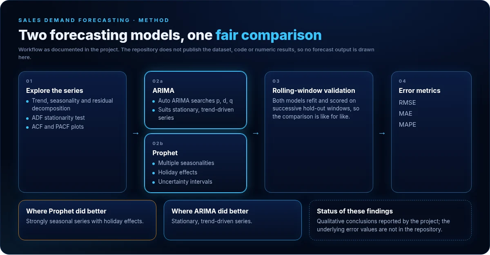
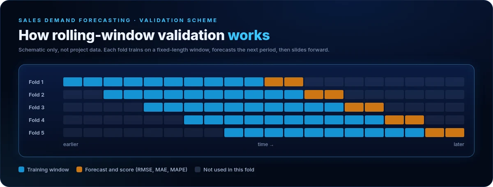

# Sales Demand Forecasting: ARIMA vs Prophet

  

**Forecasting built around a planning decision: too much stock ties up capital, too little loses sales.**

Time-series forecasting in R · Auto ARIMA · Prophet · rolling-window validation

[Portfolio](https://basant-kumar.netlify.app/) · [GitHub profile](https://github.com/basant-kumarr)

---

## The problem

Inaccurate demand forecasts lead to two costly outcomes: excess inventory, which ties up working capital in unsold stock, or stockouts, which lose sales and frustrate customers. Planners need a forecast they can order against, and evidence for which forecasting approach suits which kind of product.

## Objective

Build two established time-series models on product sales data, compare them fairly, and identify which series each model handles better.

## My contribution

I carried out the analysis in R: exploring the series, building the ARIMA and Prophet models, validating them on rolling windows and comparing their errors.

## How it works

  

**1. Exploratory analysis**
- Decomposition into trend, seasonality and residuals.
- Augmented Dickey-Fuller (ADF) test for stationarity.
- ACF and PACF plots to understand autocorrelation.

**2. ARIMA**
- Auto ARIMA searches the AR order (p), differencing (d) and MA order (q).

**3. Prophet**
- Models multiple seasonalities (daily, weekly, yearly) and holiday effects.
- Produces uncertainty intervals that are useful for planning scenarios.

**4. Evaluation**
- Rolling-window validation: each model is refit and scored on successive hold-out periods, so the comparison is like for like.
- Error metrics: RMSE, MAE and MAPE.
- Forecasts plotted with confidence intervals.

  

## Findings

| Series type | Model that performed better |
|---|---|
| Strongly seasonal, with holiday effects | Prophet |
| Stationary, trend-driven | ARIMA |

These are the project's qualitative conclusions. The underlying error values, the dataset and the R code are not published in this repository, so no forecast-versus-actual chart or metric table is shown.

## Technology

| Technology | What it contributes |
|---|---|
| R, RStudio, R Markdown | Analysis environment and reporting |
| forecast | Auto ARIMA model fitting and forecasting |
| prophet | Seasonal forecasting with holiday effects and uncertainty intervals |
| dplyr, tidyr | Data preparation |
| ggplot2 | Forecast and diagnostic charts |

## Intended use

- Inventory and procurement planning that relies on forward-looking demand signals.
- Choosing a forecasting approach per product, based on its seasonality and trend.
- Applicable to retail, supply chain and manufacturing settings.

## Limitations and what is missing

- The repository contains this write-up only: no dataset, notebook or numeric results.
- Results are described qualitatively; no improvement over a baseline is quantified here.
- Publishing the R Markdown report with RMSE, MAE and MAPE per model would make the comparison verifiable.

---

**Basant Kumar** · MSc Business Analytics, Maynooth University · [Portfolio](https://basant-kumar.netlify.app/) · [LinkedIn](https://www.linkedin.com/in/basantsingh-/) · [GitHub](https://github.com/basant-kumarr)
